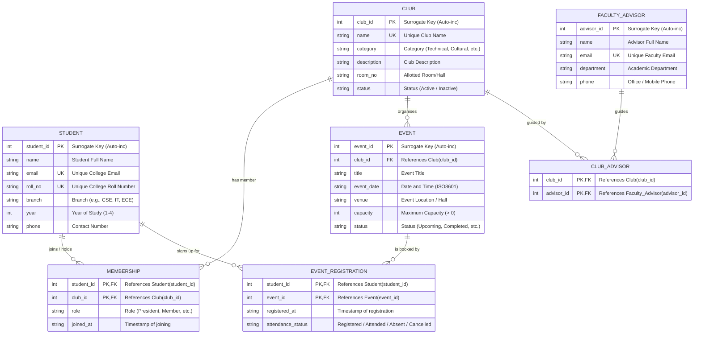

# ClubHub — Database Design & Normalization Document

## 1. Project Overview
**ClubHub** is a relational database management system designed to streamline the administration of student clubs, memberships, events, registrations, and faculty advisors in an academic college environment.

This project uses **SQLite 3** as its database engine with **Python's standard `sqlite3`** library.

---

## 2. Proposed Project Structure
```text
ClubHub/
├── database/
│   ├── schema.sql          # DDL: Table creation with constraints & indices
│   ├── seed.sql            # DML: Coherent sample data for demonstration
│   ├── init_db.py          # Python setup script to create & seed clubhub.db
│   └── clubhub.db          # Generated SQLite database file
├── docs/
│   ├── DATABASE_DESIGN.md  # Detailed schema, FDs, and 1NF/2NF/3NF proofs
│   └── erd.mmd             # Mermaid ER diagram source
├── tests/
│   └── verify_db.py        # Automated constraint and foreign-key test suite
├── static/                 # (Future phase) CSS, icons, and JavaScript
│   ├── css/
│   └── js/
├── templates/              # (Future phase) HTML templates (Bootstrap 5)
├── app.py                  # (Future phase) Flask web application
└── db.py                   # (Future phase) Database connection utilities
```

---

## 3. Entity-Relationship (ER) Diagram



---

## 4. Cardinalities and Participation Constraints

### 4.1 Relationship Summary Table
| Relationship | Entities Involved | Cardinality | Participation Constraints & Implementation Mechanism |
|---|---|---|---|
| **Event Organisation** | `Club` (1) — `Event` (N) | $1 : N$ | • **Event**: **Total participation**. An event cannot exist without a club.<br>• **Club**: **Partial participation**. A club can exist without having scheduled any events yet.<br>• *Enforcement*: Enforced at database level via `club_id INTEGER NOT NULL REFERENCES Club(club_id)`. |
| **Club Membership** | `Student` (M) — `Club` (N) | $M : N$ | • **Student**: **Partial participation**. A student does not have to join a club.<br>• **Club**: **Partial participation** in physical storage. A newly created club can exist before member rows are inserted.<br>• *Enforcement*: Resolved via `Membership` bridge table. |
| **Event Registration** | `Student` (M) — `Event` (N) | $M : N$ | • **Student**: **Partial participation**. A student is not required to register for events.<br>• **Event**: **Partial participation**. An event can exist with zero initial registrations.<br>• *Enforcement*: Resolved via `Event_Registration` bridge table. |
| **Faculty Mentorship** | `Club` (M) — `Faculty_Advisor` (N) | $M : N$ | • **Faculty_Advisor**: **Partial participation**. A professor might not advise any club.<br>• **Club**: **Partial participation** in physical storage. A club can be created before an advisor is assigned.<br>• *Enforcement*: Resolved via `Club_Advisor` bridge table. |

### 4.2 Distinguishing Business Rules from Database-Enforced Constraints
In DBMS viva examinations, students must clearly differentiate between constraints enforced by the **database engine** vs. those enforced by the **application layer**:

1. **Database-Enforced (Schema Constraints)**:
   - **Event Total Participation on Club**: Enforced because `Event.club_id` has a `NOT NULL` constraint and a foreign key referencing `Club(club_id)`. SQLite rejects any event with a missing or non-existent `club_id`.
   - **Entity Uniqueness**: Enforced by SQLite `UNIQUE` indexes on `Student(email)`, `Student(roll_no)`, `Club(name)`, and `Faculty_Advisor(email)`.
   - **Domain Integrity**: Enforced by SQLite `CHECK` constraints on `year` (1–4), `capacity` (> 0), `status`, and `role`.
   - **Duplicate Association Prevention**: Enforced by composite primary keys on all bridge tables (`Membership`, `Event_Registration`, `Club_Advisor`).

2. **Application-Enforced (Business Rules)**:
   - **Active Club Minimum Membership**: Business rule states that an active club should have at least one executive member (e.g., President). Relational databases cannot enforce minimum cardinality $\ge 1$ across separate tables without circular foreign key deadlocks. Therefore, this is enforced by application logic.
   - **Club Faculty Assignment Requirement**: Administratively, every approved club must have a faculty advisor. In SQLite storage, `Club_Advisor` is a separate table, so this requirement is governed during club approval in application logic.
   - **Event Capacity Ceiling**: The database enforces `Event.capacity > 0`. However, restricting total active registrations to $\le \text{capacity}$ is managed by application logic during registration checkout (see Section 5.8).

---

## 5. Relational Schema Details & Constraints

### 5.1 `Student`
- **Primary Key**: `student_id` (INTEGER, AUTOINCREMENT)
- **Candidate Keys**: $CK_1 = \{\text{student\_id}\}$, $CK_2 = \{\text{email}\}$, $CK_3 = \{\text{roll\_no}\}$
- **Constraints**:
  - `email`: `NOT NULL`, `UNIQUE`
  - `roll_no`: `NOT NULL`, `UNIQUE`
  - `name`, `branch`, `year`: `NOT NULL`
  - `year`: `CHECK (year BETWEEN 1 AND 4)`
  - `phone`: `CHECK (phone IS NULL OR length(phone) >= 10)`

### 5.2 `Club`
- **Primary Key**: `club_id` (INTEGER, AUTOINCREMENT)
- **Candidate Keys**: $CK_1 = \{\text{club\_id}\}$, $CK_2 = \{\text{name}\}$
- **Constraints**:
  - `name`: `NOT NULL`, `UNIQUE`
  - `category`: `NOT NULL`, `CHECK (category IN ('Technical', 'Cultural', 'Sports', 'Literary', 'Social', 'Academic'))`
  - `status`: `NOT NULL DEFAULT 'Active'`, `CHECK (status IN ('Active', 'Inactive'))`

### 5.3 `Faculty_Advisor`
- **Primary Key**: `advisor_id` (INTEGER, AUTOINCREMENT)
- **Candidate Keys**: $CK_1 = \{\text{advisor\_id}\}$, $CK_2 = \{\text{email}\}$
- **Constraints**:
  - `name`, `department`: `NOT NULL`
  - `email`: `NOT NULL`, `UNIQUE`
  - `phone`: `CHECK (phone IS NULL OR length(phone) >= 10)`

### 5.4 `Club_Advisor` (Bridge Table)
- **Primary Key**: `(club_id, advisor_id)` (Composite)
- **Foreign Keys**:
  - `club_id` $\rightarrow$ `Club(club_id)` `ON DELETE CASCADE`
  - `advisor_id` $\rightarrow$ `Faculty_Advisor(advisor_id)` `ON DELETE CASCADE`

### 5.5 `Membership` (Bridge Table)
- **Primary Key**: `(student_id, club_id)` (Composite)
- **Foreign Keys**:
  - `student_id` $\rightarrow$ `Student(student_id)` `ON DELETE CASCADE`
  - `club_id` $\rightarrow$ `Club(club_id)` `ON DELETE CASCADE`
- **Constraints**:
  - `role`: `NOT NULL DEFAULT 'Member'`, `CHECK (role IN ('President', 'Vice President', 'Secretary', 'Treasurer', 'Core Member', 'Member'))`
  - `joined_at`: `NOT NULL DEFAULT (CURRENT_TIMESTAMP)`

### 5.6 `Event`
- **Primary Key**: `event_id` (INTEGER, AUTOINCREMENT)
- **Candidate Keys**: $CK_1 = \{\text{event\_id}\}$
- **Foreign Key**:
  - `club_id` $\rightarrow$ `Club(club_id)` `ON DELETE CASCADE`
- **Constraints**:
  - `title`, `event_date`, `venue`, `capacity`: `NOT NULL`
  - `capacity`: `CHECK (capacity > 0)`
  - `status`: `NOT NULL DEFAULT 'Upcoming'`, `CHECK (status IN ('Upcoming', 'Ongoing', 'Completed', 'Cancelled'))`

### 5.7 `Event_Registration` (Bridge Table)
- **Primary Key**: `(student_id, event_id)` (Composite)
- **Foreign Keys**:
  - `student_id` $\rightarrow$ `Student(student_id)` `ON DELETE CASCADE`
  - `event_id` $\rightarrow$ `Event(event_id)` `ON DELETE CASCADE`
- **Constraints**:
  - `registered_at`: `NOT NULL DEFAULT (CURRENT_TIMESTAMP)`
  - `attendance_status`: `NOT NULL DEFAULT 'Registered'`, `CHECK (attendance_status IN ('Registered', 'Attended', 'Absent', 'Cancelled'))`

### 5.8 Event Capacity Enforcement & The 'Cancelled' Status Rule
A common viva question concerns how event capacity is enforced and how cancellations affect capacity:

1. **How Capacity is Enforced**:
   - The database schema enforces `capacity > 0` on `Event`.
   - The database does **not** count rows across `Event_Registration` to block registrations when capacity is reached. SQLite `CHECK` constraints cannot execute subqueries across tables.
   - Therefore, capacity limit enforcement is handled by **Application Logic** (in the Flask backend):
     Before inserting a new registration, the application executes:
     ```sql
     SELECT COUNT(*) FROM Event_Registration 
     WHERE event_id = ? AND attendance_status != 'Cancelled';
     ```
     If `count >= event.capacity`, the registration request is rejected with a user-friendly error ("Event is full").

2. **The 'Cancelled' Status Rule**:
   - **Rule**: Registrations with `attendance_status = 'Cancelled'` **DO NOT count towards event capacity**.
   - **Rationale**: When a student cancels their registration, their seat is freed up for another student to register.
   - **Occupancy Count Formula**:
     $$\text{Active Occupancy} = \sum [\,\text{attendance\_status} \in \{\text{'Registered'}, \text{'Attended'}, \text{'Absent'}\}\,]$$

---

## 6. Functional Dependencies (FDs) and Normalization Proofs

To prove normalization rigorously for a viva examination, we define the prime attributes (attributes belonging to any candidate key) and non-prime attributes for every relation.

### Table 1: `Student`
- **Attributes**: `(student_id, name, email, roll_no, branch, year, phone)`
- **Candidate Keys**: $CK_1 = \{\text{student\_id}\}$, $CK_2 = \{\text{email}\}$, $CK_3 = \{\text{roll\_no}\}$
- **Primary Key**: $\text{student\_id}$
- **Prime Attributes**: `student_id`, `email`, `roll_no`
- **Non-Prime Attributes**: `name`, `branch`, `year`, `phone`
- **Functional Dependencies (FDs)**:
  1. $\text{student\_id} \rightarrow \text{name, email, roll\_no, branch, year, phone}$
  2. $\text{email} \rightarrow \text{student\_id, name, roll\_no, branch, year, phone}$
  3. $\text{roll\_no} \rightarrow \text{student\_id, name, email, branch, year, phone}$
- **1NF**: All attributes contain single atomic values (scalar text/integer); no repeating groups or multi-valued columns.
- **2NF**: A relation is in 2NF if it is in 1NF and no non-prime attribute is partially dependent on any candidate key. Since all candidate keys consist of single attributes ($\text{student\_id}$, $\text{email}$, $\text{roll\_no}$), no proper subset of a key can exist. Hence, partial dependency is mathematically impossible. Therefore, `Student` is in 2NF.
- **3NF**: A relation is in 3NF if for every non-trivial functional dependency $X \rightarrow Y$, either:
  1. $X$ is a superkey, OR
  2. $Y$ consists solely of prime attributes.
  In FDs (1), (2), and (3), the left-hand sides ($\text{student\_id}$, $\text{email}$, $\text{roll\_no}$) are all superkeys. Furthermore, there are no transitive dependencies between non-prime attributes (e.g. `branch` does not determine `year` or `phone`). Therefore, `Student` is in 3NF (and also BCNF).

---

### Table 2: `Club`
- **Attributes**: `(club_id, name, category, description, room_no, status)`
- **Candidate Keys**: $CK_1 = \{\text{club\_id}\}$, $CK_2 = \{\text{name}\}$
- **Primary Key**: $\text{club\_id}$
- **Prime Attributes**: `club_id`, `name`
- **Non-Prime Attributes**: `category`, `description`, `room_no`, `status`
- **Functional Dependencies (FDs)**:
  1. $\text{club\_id} \rightarrow \text{name, category, description, room\_no, status}$
  2. $\text{name} \rightarrow \text{club\_id, category, description, room\_no, status}$
- **1NF**: Satisfied (atomic domain values, no comma-separated lists).
- **2NF**: Satisfied (all candidate keys are single attributes; no partial dependencies exist).
- **3NF**: Satisfied (for all FDs, the LHS is a superkey; no non-prime attribute determines another non-prime attribute. Note: multiple clubs can share an allotted room over time, so `room_no` does not determine `name` or `club_id`).

---

### Table 3: `Faculty_Advisor`
- **Attributes**: `(advisor_id, name, email, department, phone)`
- **Candidate Keys**: $CK_1 = \{\text{advisor\_id}\}$, $CK_2 = \{\text{email}\}$
- **Primary Key**: $\text{advisor\_id}$
- **Prime Attributes**: `advisor_id`, `email`
- **Non-Prime Attributes**: `name`, `department`, `phone`
- **Functional Dependencies (FDs)**:
  1. $\text{advisor\_id} \rightarrow \text{name, email, department, phone}$
  2. $\text{email} \rightarrow \text{advisor\_id, name, department, phone}$
- **1NF**: Satisfied (scalar values).
- **2NF**: Satisfied (single-attribute candidate keys, no partial dependencies).
- **3NF**: Satisfied (LHS of every FD is a superkey; `department` has multiple faculty members and does not uniquely determine `phone` or `name`, so no transitive dependencies exist).

---

### Table 4: `Club_Advisor`
- **Attributes**: `(club_id, advisor_id)`
- **Candidate Key / Primary Key**: $CK_1 = \{\text{club\_id, advisor\_id}\}$ (Composite)
- **Prime Attributes**: `club_id`, `advisor_id`
- **Non-Prime Attributes**: None ($\emptyset$)
- **Functional Dependencies (FDs)**:
  - $\text{club\_id, advisor\_id} \rightarrow \emptyset$ (trivial dependencies only)
- **1NF**: Satisfied.
- **2NF**: Satisfied trivially because there are no non-prime attributes to be partially dependent on the composite key.
- **3NF**: Satisfied trivially because there are no non-prime attributes to be transitively dependent.

---

### Table 5: `Membership`
- **Attributes**: `(student_id, club_id, role, joined_at)`
- **Candidate Key / Primary Key**: $CK_1 = \{\text{student\_id, club\_id}\}$ (Composite)
- **Prime Attributes**: `student_id`, `club_id`
- **Non-Prime Attributes**: `role`, `joined_at`
- **Functional Dependencies (FDs)**:
  1. $\{\text{student\_id, club\_id}\} \rightarrow \text{role, joined\_at}$
- **1NF**: Satisfied (atomic fields).
- **2NF**: A student can have different roles in different clubs (e.g. President in Club 1, Member in Club 2). Therefore, `student_id` alone does not determine `role`. Similarly, a club has many members with various roles, so `club_id` alone does not determine `role`. Both `role` and `joined_at` depend on the **entire composite key** $\{\text{student\_id, club\_id}\}$. There are no partial dependencies on a proper subset of the key. Hence, `Membership` is in 2NF.
- **3NF**: The only non-trivial FD has the composite primary key as its LHS, which is a superkey. There is no dependency between `role` and `joined_at` ($\text{role} \not\rightarrow \text{joined\_at}$). Hence, no transitive dependency exists. Therefore, `Membership` is in 3NF.

---

### Table 6: `Event`
- **Attributes**: `(event_id, club_id, title, event_date, venue, capacity, status)`
- **Candidate Key / Primary Key**: $CK_1 = \{\text{event\_id}\}$
- **Prime Attribute**: `event_id`
- **Non-Prime Attributes**: `club_id`, `title`, `event_date`, `venue`, `capacity`, `status`
- **Functional Dependencies (FDs)**:
  1. $\text{event\_id} \rightarrow \text{club\_id, title, event\_date, venue, capacity, status}$
- **1NF**: Satisfied (atomic values).
- **2NF**: Satisfied (primary key is single-attribute; no partial dependencies).
- **3NF**: In FD (1), $\text{event\_id}$ is a superkey. No non-prime attribute determines another (e.g., `venue` does not determine `capacity` because capacity is the event's registration limit rather than hall size; `club_id` does not determine `event_date`). Therefore, no transitive dependencies exist among non-prime attributes. `Event` is in 3NF.

---

### Table 7: `Event_Registration`
- **Attributes**: `(student_id, event_id, registered_at, attendance_status)`
- **Candidate Key / Primary Key**: $CK_1 = \{\text{student\_id, event\_id}\}$ (Composite)
- **Prime Attributes**: `student_id`, `event_id`
- **Non-Prime Attributes**: `registered_at`, `attendance_status`
- **Functional Dependencies (FDs)**:
  1. $\{\text{student\_id, event\_id}\} \rightarrow \text{registered\_at, attendance\_status}$
- **1NF**: Satisfied.
- **2NF**: `student_id` alone does not determine attendance. `event_id` alone does not determine attendance. Both attributes depend fully on the composite key $\{\text{student\_id, event\_id}\}$. No partial dependencies exist. Hence, `Event_Registration` is in 2NF.
- **3NF**: The only non-trivial FD has the composite key (a superkey) as its LHS. There is no dependency between `attendance_status` and `registered_at`. Hence, no transitive dependencies exist. Therefore, `Event_Registration` is in 3NF.

---

## 7. Key Design Decisions & Delete Behaviors Explained

### 7.1 Deletion Scenarios (Referential Actions)
| Entity Deleted | What Happens to Dependent Records? | Reason / Viva Explanation |
|---|---|---|
| **Student** | • `Membership` records are deleted.<br>• `Event_Registration` records are deleted. | Enforced by `ON DELETE CASCADE`. Avoids orphaned registrations and memberships when a student leaves the college. |
| **Club** | • `Membership` records are deleted.<br>• `Club_Advisor` records are deleted.<br>• `Event` records are deleted.<br>• (Transitively) `Event_Registration` records are deleted. | Enforced by `ON DELETE CASCADE`. If a club is disbanded, all its internal events and memberships dissolve. |
| **Faculty_Advisor** | • `Club_Advisor` link record is deleted.<br>• **Club remains intact.** | When a professor leaves or changes advising roles, only the mentorship link is removed. The club continues to operate. |
| **Event** | • `Event_Registration` records are deleted.<br>• **Club and Student remain intact.** | Cancelling or deleting an event cleans up its sign-up list without deleting student or club profiles. |

### 7.2 Surrogate vs. Composite Keys
- **Surrogate Keys**: Used on core independent entities (`Student`, `Club`, `Faculty_Advisor`, `Event`) to keep foreign keys compact, stable, and fast.
- **Composite Primary Keys**: Used on junction tables (`Membership`, `Event_Registration`, `Club_Advisor`) to strictly prevent duplicate pairings at the schema level without extra sequence overhead.
